# Sredzap

Sredzap is a uild a small automation app inspired by Zapier’s. You signing in
with GitHub and a Zap comments on a pull request when one is opened.

## Requirements

  - Node.js v20.10.0 installed (nvm is nice to have to manage different node versions)
  - MongoDB installed (MongoDB Compass GUI to manipulate data easier)
  - @angular/cli@17.0.10
  - ngrok (To expose your local API and being reachable by github.com )
  - git 
  - An OAuth App in github for the application
  

## Installation

#### NVM, node.js, and @angular/cli@17.0.10

 - Unistall previus versions of node from control panel.
 - Download and install the latest version of nvm from [NVM downloads](https://www.nvmnode.com/guide/download.html) 
 - Open a terminal and verify it is running

```
nvm version
```

 - Use the following command to install the node version that you want

```
nvm instal 20.10.0
```

 - Then this command to work with it

```
nvm use 20.10.0
```     

 - Verify the node version 

```
node --version
```

 - Then install @angular/cli@17.0.10 with 

```
npm install -g @angular/cli@17.0.10
```

#### MongoDB and Mongo Compass

 - Download MongoDB from [MongoDB Downloads](https://www.mongodb.com/try/download/community) 

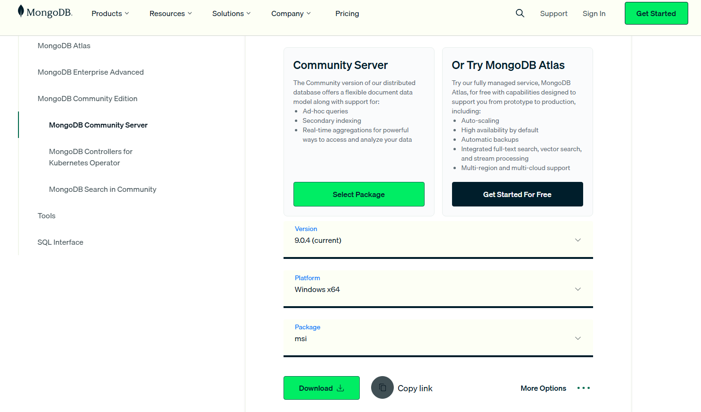

 - In the installation process you have to select the complete option and click next until the end.

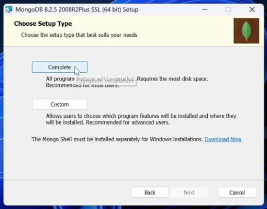

 - Verify that you mark the check button for Install MongoDb Compass

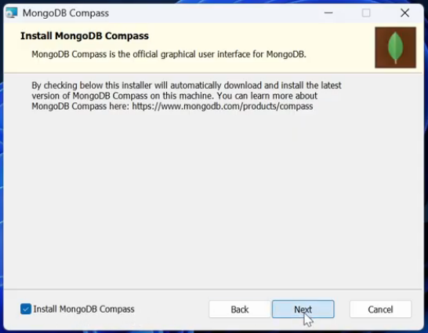

 - Once It is finished create a database for the project

#### Clone repository

 - Open a terminal and go to your wished directory, then run the following command (verify that git is installed with `git --version` )

```
git clone https://github.com/ezequiel-flores-schmelensky/sredzap.git
```

 - once is clone you have to create .env file for the database and github credentials in the root folder of the project

```
GITHUB_CLIENT_ID=Get_it_from_github
GITHUB_CLIENT_SECRET=Get_it_from_github
MONGO_URI=mongodb://localhost:27017/example
PORT=3000
JWT_SECRET=sredzap2026
WEB_APP=http://localhost:4200
```

#### Create a new OAuth App

- Sign in on your github account, then click in your profile picture, and then settings

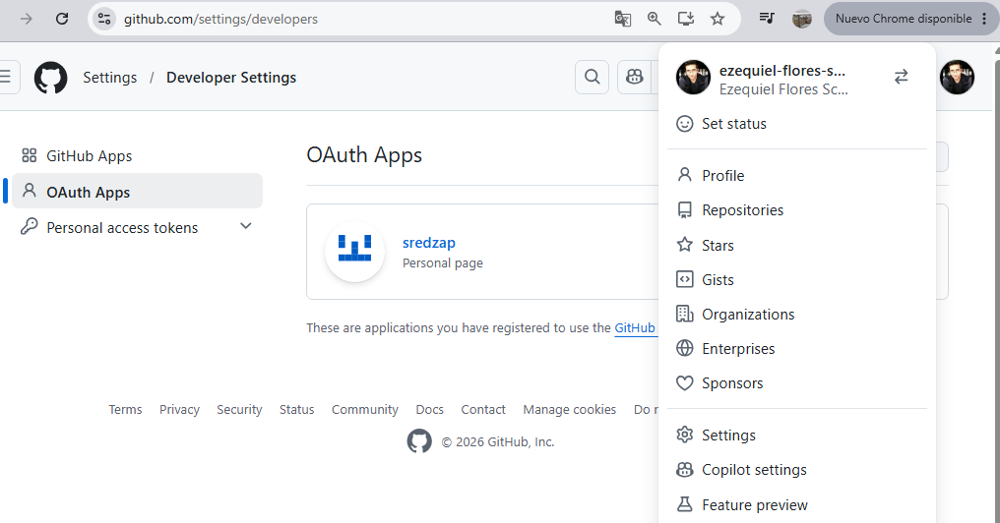

- Look for Developer settings option, then OAuth Apps, and finally New OAuth App

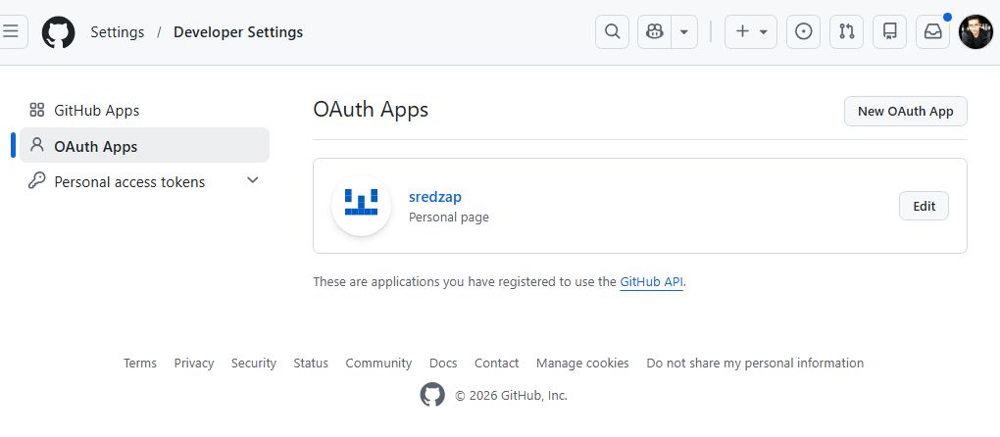

- Fill up the required fields, and add a Redirect URI with the following URL, and click register app button

```
http://localhost:3000/api/auth/github/callback
```

- Then you will get your Client ID, and you have to generate a new client secret

#### Opening API port for github webhooks

If you are running locally your project, github is not able to send any notification to your API. Ngrok provides a URL that github can hit.

- Download and install [Ngrok downloads](https://ngrok.com/)
- Sign in into Ngrok to obtain your token.
- Authenticate in your terminal using your Ngrok token by running:

```
ngrok config add-authtoken YOUR_TOKEN
```

- Expose the port on which your Node.js backend runs by executing this command:

```
ngrok http 3000
```

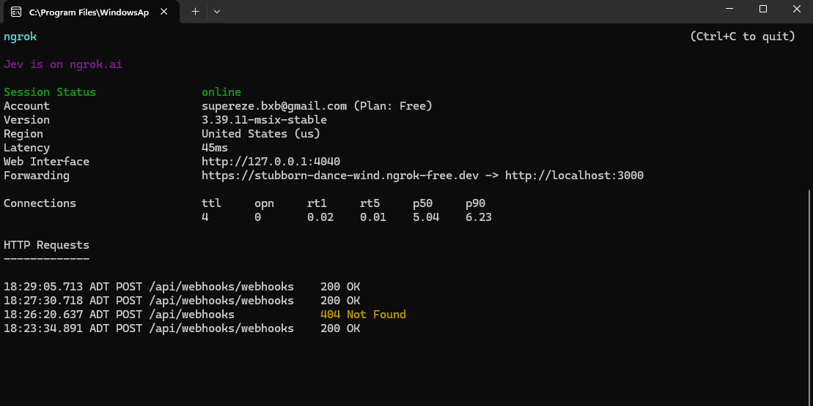

- Copy the public HTTPS URL that Ngrok generates in the terminal for the next section


#### Configuring webhook to notify every event in a repository

- Go into the git repository that you want to use for listening the PR
- Then, look for settings tab and click on webhooks option 

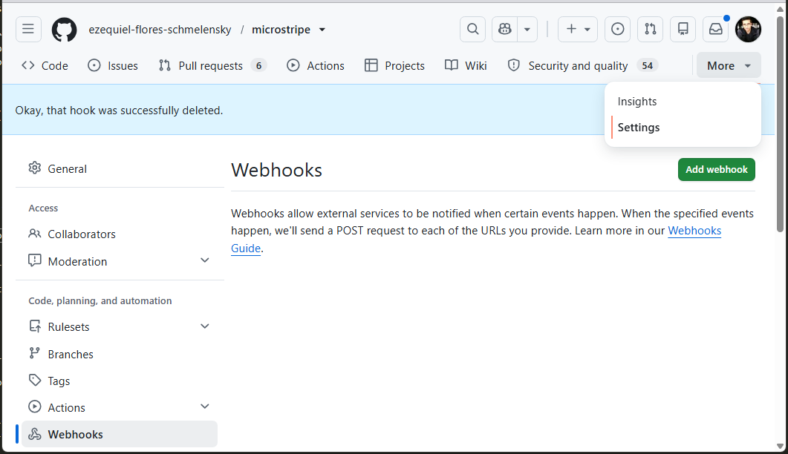

- Click in create "Add webhook" button and fill up the fields, Payload URL is generated by ngrok in the previous section 

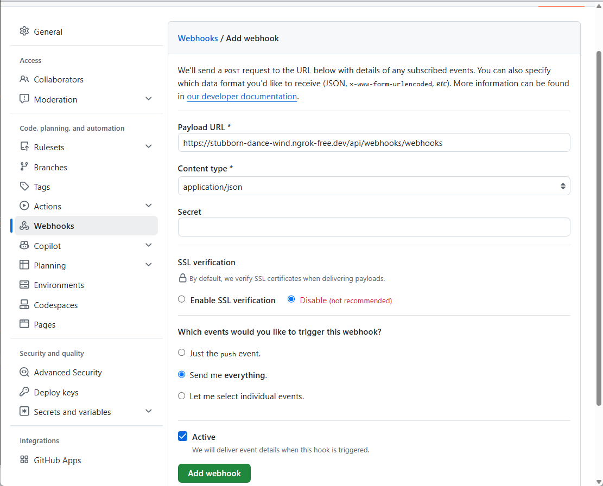

#### Running Angular app and node server

- Running node server, Open a terminal and got to the project root folder

```
npx tsx src/app.ts
```
NOTE: tsx command is replacing ts-node because is not working with "typescript": "^7.0.2"

- Running angular server, Open a new terminal and go to your_path/sredzap/sredzap path

```
ng server
```

- Open a browser and go to http://localhost:4200/ you have to see the next page

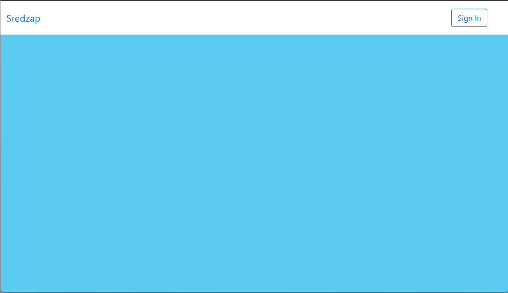

- Click "Sign In" button to login, then click in "Log in with Github" button

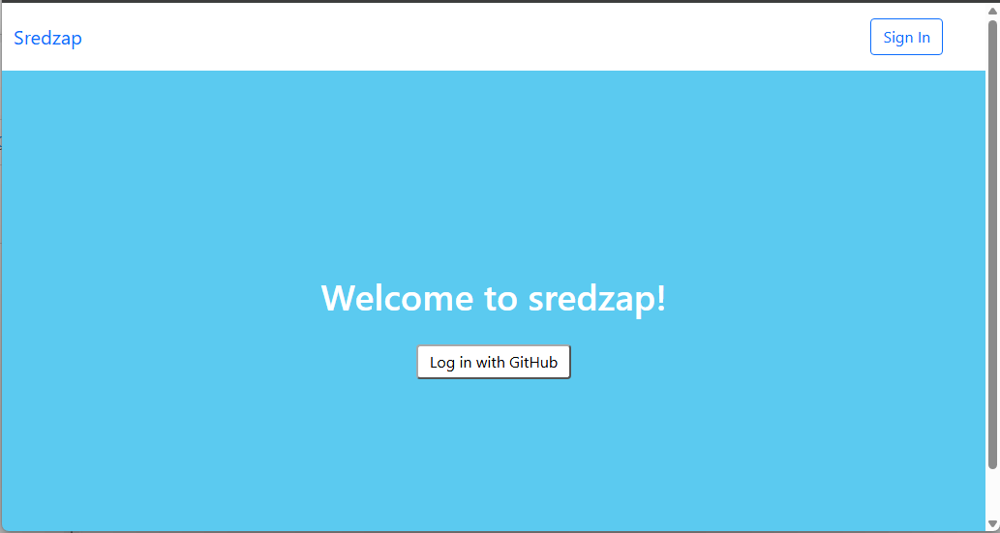

- It will redirect to the following page, enter you github credentials and login in

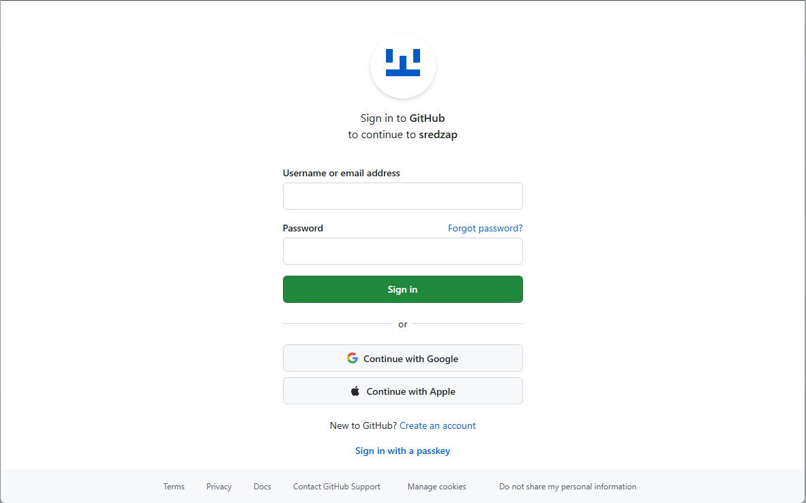

- If your credentials are correct you will be redirected to, authenticate 

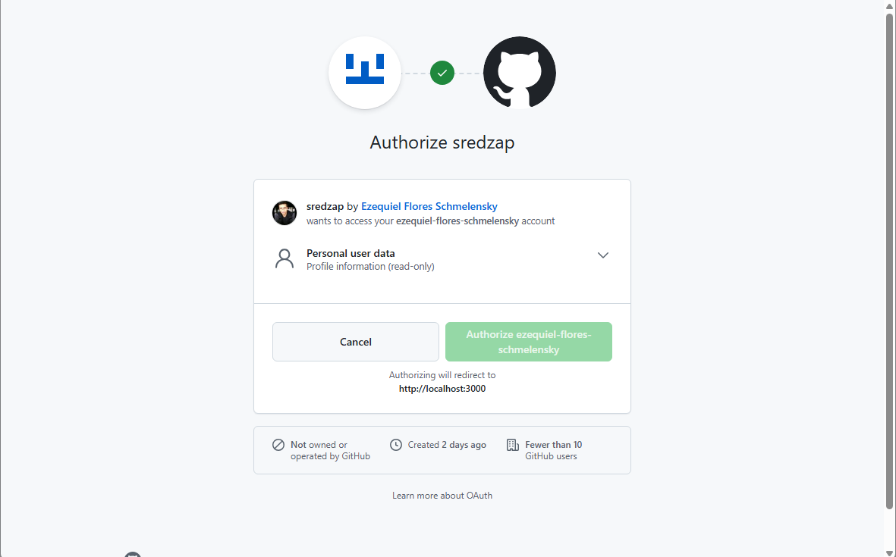

- If all is correct you will be redirected to dashboard page where you can create your first Zap

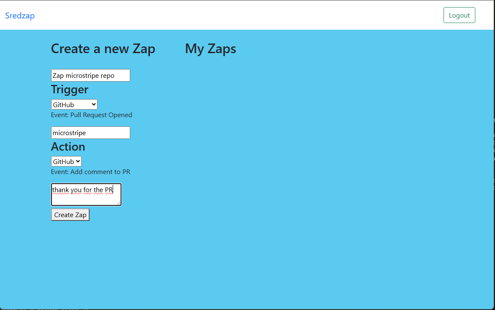

- If the data es correct you will see the following alert

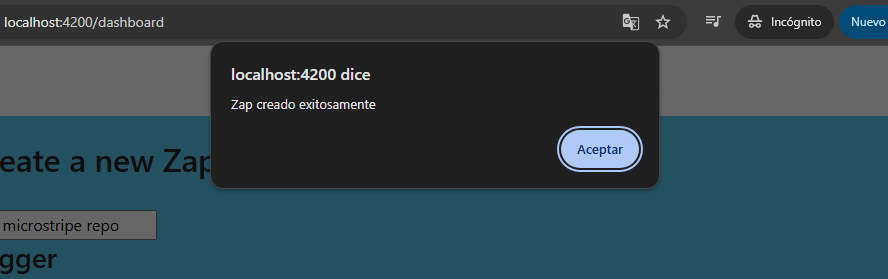

- Then, is time to create a PR in the repository that you configurated, and see if all is working.

Good luck!